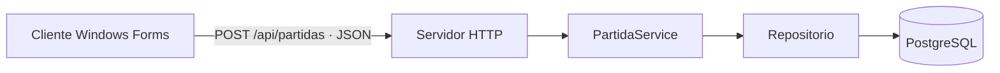

# Avión moderno integrado con POO y cliente-servidor

La práctica consiste en mostrar las aeronaves en un formulario y aplicar buenas prácticas de programación dentro de un proyecto cliente-servidor. Se mantiene C# / .NET 10 con Windows Forms y el servidor HTTP existente.

Para repartir la presentación, consultar la [exposición para cinco personas](EXPOSICION-5-PERSONAS.md), con archivos, bloques de código y guiones por integrante.

## Imagen del avión

Se utiliza el caza moderno de la primera propuesta: `Assets/condor-fighter.png`, un PNG de 1024 × 1536 con transparencia. Es una imagen conceptual generada con **imagegen**. El mismo archivo aparece como jugador y rival; el rival se gira 180 grados. Las marcas turquesa y naranja identifican cada bando.

La pantalla conserva una presentación oscura, con el escenario, las aeronaves y las vidas. La vista inicial muestra el avión ampliado para presentar su diseño.

`FlightCanvas` carga el PNG con `Image.FromFile` y lo dibuja con `DrawImage` en la posición del objeto `Aeronave`. El proyecto copia el archivo a la carpeta de salida al compilar y publicar. Para usar un dibujo propio del grupo, basta con sustituir este PNG, conservando su nombre, transparencia y orientación hacia arriba.

## Programación orientada a objetos

La clase `Aeronave`, en `JuegoAviones.Core/Entidades/Aeronave.cs`, representa a cada avión. Es una clase base abstracta: `AeronaveJugador` y `AeronaveRival` heredan sus atributos y métodos comunes. Los objetos se manejan a través del tipo base `Aeronave`.

| Atributo o propiedad | Qué representa |
| --- | --- |
| `Nombre` | Identificación de la aeronave |
| `Posicion` | Coordenadas X e Y dentro del escenario |
| `Tamano` | Tamaño del rectángulo utilizado para detectar impactos |
| `Vida` | Integridad actual |
| `VidaInicial` | Vida con la que inicia la aeronave |
| `EsRival` | Identifica el bando y su orientación al dibujarse |

`CrearDisparo()` es un método abstracto. Cada clase hija lo sobrescribe con `override`: el jugador crea un disparo delante de su avión orientado hacia arriba y el rival, uno orientado hacia abajo. `FlightGame` llama al mismo método sobre ambos objetos y obtiene el comportamiento de cada clase: este es el ejemplo de **polimorfismo**. La orientación al dibujar también depende de `AnguloRotacion`, que cada hija implementa.

`MoverA(x, y)` cambia la posición. `RecibirImpacto(dano)` reduce la vida sin permitir valores negativos. Las propiedades de posición y vida tienen `private set`: el estado cambia a través de los métodos de la clase. Esto es **encapsulación**.

`FlightGame` coordina las aeronaves: inicia la partida, recibe los movimientos, crea los disparos, comprueba colisiones y determina victoria o derrota. `FlightCanvas` se ocupa de dibujar. `Form1` recibe el teclado y envía el resultado al servidor.

## Arquitectura cliente-servidor



El movimiento y el combate se calculan localmente en Core. Al terminar la partida, el formulario envía el resultado a `http://localhost:5080/api/partidas`.

En el servidor, el endpoint recibe el DTO, llama a `PartidaService.RegistrarAsync`, valida el resultado con la entidad `Partida` y lo guarda mediante `IPartidaRepository`. La implementación del repositorio usa PostgreSQL. El servidor también permite consultar el ranking. No es un combate multijugador sincronizado por red.

## Buenas prácticas que se pueden demostrar

- **Separación de responsabilidades:** modelo y reglas en Core, dibujo en Render y comunicación desde el formulario.
- **Encapsulación:** la aeronave modifica su posición y vida mediante métodos.
- **Herencia y polimorfismo:** las dos clases hijas reutilizan la base y sobrescriben `CrearDisparo` y `AnguloRotacion`.
- **Parámetros y argumentos:** en `RecibirImpacto(int dano)`, `dano` es el parámetro; en `RecibirImpacto(10)`, `10` es el argumento.
- **Procedimientos y funciones:** `MoverA` y `RecibirImpacto` devuelven `void`; `CrearDisparo` devuelve un objeto `Projectile`.
- **Validación:** no se permiten una aeronave sin nombre, tamaños inválidos ni daños negativos.
- **Reutilización:** jugador y rival usan la misma clase y el mismo método de dibujo.
- **Comunicación asíncrona:** el envío HTTP no bloquea la ventana; se informa si el servidor no responde.
- **Pruebas automatizadas:** verifican movimiento, pausa, disparos, impactos, victoria, derrota y reinicio.

## Profiling y métricas medibles

El temporizador de `FlightCanvas` usa `Stopwatch.GetTimestamp` antes de `game.Update` y `Stopwatch.GetElapsedTime` después. Durante una partida activa reúne 60 muestras y muestra el tiempo promedio de una actualización de la lógica, en milisegundos. No incluye el dibujo, el envío HTTP ni los períodos de pausa.

Puedes usar este dato para comparar el costo de actualizar la lógica antes y después de modificarla. El valor depende del equipo y no se presenta como un valor fijo. Las pruebas automatizadas permiten medir cuántos casos verificados pasan o fallan.

El funcionamiento cliente-servidor se demuestra iniciando PostgreSQL y el servidor, terminando una partida y comprobando el resultado guardado. Un indicador de vida es una medida del juego; por sí solo no es una métrica de calidad del software. Las pruebas y la separación de responsabilidades permiten explicar la calidad de esta implementación. Cualquier métrica adicional debe ajustarse a lo que el docente haya pedido expresamente.

## Guía breve para exponer

1. Mostrar la imagen integrada en el formulario.
2. Abrir `Aeronave.cs` e identificar atributos, constructor y métodos. Mostrar las dos clases hijas y sus `override`.
3. Mostrar cómo `FlightGame` usa `MoverA` y `RecibirImpacto`.
4. Mostrar cómo `DrawPlane` recibe el objeto y dibuja su imagen en la posición correspondiente.
5. Explicar el caso de uso de registrar una partida: formulario → HTTP → servicio → repositorio → base de datos.
6. Demostrar movimiento, disparos y disminución de vida; mostrar el tiempo promedio de actualización y ejecutar las pruebas.

Una explicación breve sería: «Cada avión es un objeto de la clase Aeronave. Core controla sus movimientos e impactos, el formulario lo dibuja y el cliente envía el resultado al servidor para guardarlo».

## Ejecutar desde CMD de Windows

```cmd
pushd \\wsl.localhost\Ubuntu\home\david\Trabajos_U\juego-de-aviones
dotnet build JuegoAviones.csproj --no-incremental
dotnet run --project JuegoAviones.csproj --no-build
```

Flechas para moverse, Enter/Espacio para disparar, P/Esc para pausar y R para reiniciar. Enter inicia la partida.

Para guardar resultados, iniciar PostgreSQL y el servidor según el README.

## Prompt de la imagen original

```text
Use case: stylized-concept
Asset type: transparent sprite for a vertical scrolling 2D airplane combat game, also suitable as an aircraft preview.
Primary request: one impressive modern next-generation fictional stealth fighter aircraft seen strictly from above, nose pointing vertically upward. A polished detailed game illustration of a sleek angular fuselage, broad swept diamond wings, two rear engines, small angled tail fins, glossy smoked cyan cockpit, metallic graphite and silver panels with subtle cyan accents. Symmetrical aircraft, clearly readable silhouette, no perspective tilt.
Composition: single aircraft fully visible and centered, nearly filling a portrait canvas with generous transparent margin on all sides. Aircraft width about 75 percent of its length. Crisp silhouette, fine panel details and realistic metallic shading that reads at small sprite size.
Backdrop: genuinely transparent alpha background.
Constraints: exactly one aircraft, orthographic top-down view, no text, no logos, no missiles or separate objects, no frame, no ground shadow, no smoke, no engine flame outside silhouette.
```
