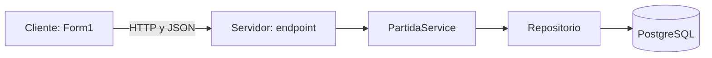

# Exposición del juego de aviones para cinco personas

Duración sugerida: **10 a 12 minutos**, aproximadamente dos minutos por integrante y una demostración breve. Cada persona abre los archivos de su parte y explica los bloques indicados. Los fragmentos de esta guía corresponden al código del proyecto.

## Reparto y archivos que deben tener abiertos

Las rutas se indican desde la carpeta principal del proyecto. En Visual Studio o VS Code pueden usar **Ctrl + G** para ir a la línea inicial.

| Persona | Tema | Archivo y línea inicial | Bloque principal |
| --- | --- | --- | --- |
| 1 | Objetivo y cliente-servidor | `Form1.cs`, línea 63 | `OnCompleted` y envío HTTP |
| 1 | Caso de uso de registro | `JuegoAviones.Core/CasosDeUso/PartidaService.cs`, línea 8 | `RegistrarAsync` |
| 2 | Clase, atributos y encapsulación | `JuegoAviones.Core/Entidades/Aeronave.cs`, línea 6 | Propiedades, constructor, `MoverA` y `RecibirImpacto` |
| 3 | Herencia y polimorfismo | `JuegoAviones.Core/Entidades/AeronaveJugador.cs`, línea 3; `AeronaveRival.cs`, línea 3 | Herencia y métodos `override` |
| 4 | Imagen y funcionamiento | `Render/FlightCanvas.cs`, línea 122 | `DrawPlane` |
| 4 | Movimiento e impactos | `JuegoAviones.Core/Gameplay/FlightGame.cs`, línea 54 | `Update` |
| 5 | Profiling | `Render/FlightCanvas.cs`, línea 41 | Medición con `Stopwatch` y promedio |
| 5 | Pruebas | `JuegoAviones.Tests/FlightGameTests.cs`, línea 8 | `ReadyAndPaused_DoNotAdvanceOrFire` |

Los números de línea corresponden a esta versión; si el código cambia, busquen los nombres de los métodos.

## Persona 1: objetivo, arquitectura y caso de uso

### Qué puede decir

> La práctica consiste en mostrar aeronaves en un formulario y aplicar programación orientada a objetos y buenas prácticas. El proyecto utiliza C# con Windows Forms. El cliente muestra el juego y recibe el teclado; Core coordina el combate. Cuando termina una partida, el cliente envía el resultado al servidor HTTP. El servidor valida la partida y utiliza un repositorio para guardarla en PostgreSQL. Este es el caso de uso de registrar una partida.

### Código para mostrar

En `Form1.cs`, dentro de `OnCompleted`:

```csharp
using var response = await api.PostAsJsonAsync("/api/partidas", new
{
    jugador = "Jugador",
    resultado = game.State == FlightState.Victory ? "Ganaste" : "Perdiste",
    vidaJugador = game.PlayerHealth,
    vidaRival = game.EnemyHealth
}, lifetime.Token);
```

Explicar que `PostAsJsonAsync` envía esos datos como JSON. `await` permite esperar la respuesta sin bloquear la ventana. El cliente utiliza `http://localhost:5080`, configurado en el mismo archivo.

En `PartidaService.cs`, dentro de `RegistrarAsync`:

```csharp
var partida = Partida.RegistrarResultado(jugador, resultado, vidaJugador, vidaRival);
await partidas.AgregarAsync(partida, cancellationToken);
return partida;
```

El servicio crea una partida validada y solicita al repositorio guardarla. El endpoint que llama al servicio está en `JuegoAviones.Servidor/Red/PartidasEndpoints.cs`; la implementación del repositorio está en `JuegoAviones.Data/Repositorios/PartidaRepository.cs`.



### Demostración y pregunta posible

Mostrar el juego y señalar jugador, rival y vidas. Si el servidor y PostgreSQL están activos, terminar una partida y comprobar el ranking.

**¿Qué hace el servidor?** Valida y guarda los resultados, y permite consultar el ranking. El movimiento del combate se calcula localmente en Core; esta versión no sincroniza un combate multijugador por red.

## Persona 2: clase, atributos, constructor y encapsulación

### Qué puede decir

> La clase Aeronave reúne las características comunes de los aviones: nombre, posición, tamaño, vida y bando. El constructor recibe estos datos y valida que sean correctos. La posición y la vida tienen private set, por lo que su modificación se realiza mediante métodos. MoverA cambia las coordenadas y RecibirImpacto reduce la vida sin permitir que quede negativa. Esto es encapsulación: el objeto controla cómo cambia su estado.

### Código para mostrar

En `Aeronave.cs`, señalar estas propiedades:

```csharp
public string Nombre { get; }
public PointF Posicion { get; private set; }
public SizeF Tamano { get; }
public int Vida { get; private set; }
```

Después, mostrar el constructor `protected Aeronave(...)` y sus validaciones. La clase es abstracta y su constructor es utilizado por las clases hijas.

Mostrar este método:

```csharp
public void RecibirImpacto(int dano)
{
    if (dano <= 0) throw new ArgumentOutOfRangeException(nameof(dano));
    Vida = Math.Max(0, Vida - dano);
}
```

`dano` es un **parámetro**, definido en el método. En la llamada `AvionRival.RecibirImpacto(10)`, el valor `10` es el **argumento** enviado.

En C#, tanto los procedimientos como las funciones se expresan mediante métodos. `RecibirImpacto` y `MoverA` devuelven `void`, por lo que se pueden explicar como procedimientos. `CrearDisparo` devuelve un objeto y se puede explicar como una función.

### Demostración y pregunta posible

Señalar en pantalla la vida del jugador y del rival; explicar que cada impacto descuenta 10.

**¿Por qué usar `private set`?** Permite consultar la vida desde otras clases, pero concentra su modificación en los métodos del objeto, donde se aplican las reglas y validaciones.

## Persona 3: herencia y polimorfismo

### Qué puede decir

> AeronaveJugador y AeronaveRival heredan de Aeronave. Así comparten sus atributos y los métodos de movimiento e impactos. La clase base declara CrearDisparo como abstracto y cada hija lo implementa con override. Core puede manejar ambos objetos como Aeronave y llamar al mismo método; se ejecuta la implementación correspondiente al tipo real del objeto. Ese es el ejemplo de polimorfismo del proyecto.

### Código para mostrar

En `Aeronave.cs`:

```csharp
public abstract Projectile CrearDisparo();
```

En `AeronaveJugador.cs`, mostrar la declaración de clase y su implementación:

```csharp
public sealed class AeronaveJugador : Aeronave
```

```csharp
public override Projectile CrearDisparo() => new(Posicion.X, Posicion.Y - 42, false);
```

En `AeronaveRival.cs`:

```csharp
public sealed class AeronaveRival : Aeronave
```

```csharp
public override Projectile CrearDisparo() => new(Posicion.X, Posicion.Y + 46, true);
```

Las declaraciones de clase anteriores son fragmentos: el cuerpo completo está en cada archivo. El jugador crea el proyectil delante de su avión hacia arriba y el rival, delante del suyo hacia abajo. El último argumento identifica si el proyectil pertenece al rival; `FlightGame` utiliza ese dato para moverlo y comprobar sus impactos.

Para demostrar que se usa realmente el polimorfismo, señalar estas llamadas dentro de `FlightGame.Update`:

```csharp
projectiles.Add(AvionJugador.CrearDisparo());
```

```csharp
projectiles.Add(AvionRival.CrearDisparo());
```

Ambas propiedades están declaradas con el tipo base `Aeronave`. La orientación al dibujar también se implementa en las clases hijas: `AnguloRotacion` vale 0 para el jugador y 180 para el rival.

### Demostración y pregunta posible

Disparar y mostrar que los disparos del jugador suben mientras los del rival bajan.

**¿Cuál es la diferencia entre herencia y polimorfismo?** La herencia permite compartir lo definido en la clase base. El polimorfismo permite utilizar una operación común con el comportamiento implementado por cada clase hija.

## Persona 4: imagen, movimiento y colisiones

### Qué puede decir

> La imagen del avión se carga desde un PNG con transparencia. El método DrawPlane recibe un objeto Aeronave, toma sus coordenadas y dibuja la imagen en esa posición. La orientación depende del tipo de avión. El temporizador actualiza la lógica y solicita volver a dibujar. Cuando un disparo se cruza con el rectángulo del avión contrario, se considera un impacto y se reduce la vida.

### Código para mostrar

En `FlightCanvas.cs`, dentro de `DrawPlane`:

```csharp
g.TranslateTransform(avion.Posicion.X, avion.Posicion.Y);
g.RotateTransform(avion.AnguloRotacion);
float width = avion.EsRival ? 78 : 64;
float height = avion.EsRival ? 112 : 96;
g.DrawImage(aircraftImage, -width / 2, -height / 2, width, height);
```

La imagen se carga en el constructor con `Image.FromFile`. `Graphics.Save` y `Restore` permiten que la transformación de un avión no afecte al resto del escenario. `DoubleBuffered` reduce el parpadeo.

En `FlightGame.cs`, dentro de `Update`, mostrar el movimiento:

```csharp
AvionJugador.MoverA(
    Math.Clamp(Player.X + horizontal * 270 * dt, 34, Width - 34),
    Math.Clamp(Player.Y + vertical * 270 * dt, 190, Height - 48));
```

Las coordenadas cambian según la dirección y el tiempo transcurrido. `Math.Clamp` mantiene el avión dentro de los límites establecidos.

Mostrar la condición de impacto:

```csharp
if (shot.Bounds.IntersectsWith(shot.Enemy ? PlayerBounds : EnemyBounds))
```

Dentro de ese bloque, se elimina el proyectil y se llama a `RecibirImpacto(10)`. Si una vida llega a cero, se determina victoria o derrota y se dispara el evento `Completed`.

### Demostración y pregunta posible

Moverse hasta un borde, disparar y mostrar la disminución de la vida. Pausar con P para detener la demostración mientras se explica el código.

**¿Cómo se detecta un impacto?** Se comprueba si se cruzan los rectángulos del proyectil y de la aeronave contraria. Es una aproximación sencilla; no se comprueba cada píxel de la imagen.

## Persona 5: profiling, pruebas y buenas prácticas

### Qué puede decir

> Medimos el tiempo que tarda una actualización de la lógica con Stopwatch. Durante una partida activa reunimos 60 muestras y mostramos su promedio en milisegundos. También tenemos pruebas automatizadas para comprobar reglas del juego y validaciones de los registros. En la última ejecución comprobada pasaron 13 pruebas y no falló ninguna. La separación entre modelo, dibujo y comunicación facilita entender el código y probarlo.

### Código para mostrar

En el temporizador de `FlightCanvas.cs`:

```csharp
long started = Stopwatch.GetTimestamp();
game.Update(seconds, horizontal, vertical, fire);
```

Después de la actualización:

```csharp
updateTotalMilliseconds += Stopwatch.GetElapsedTime(started).TotalMilliseconds;
updateSamples++;
```

Al reunir 60 muestras:

```csharp
updateAverageMilliseconds = updateTotalMilliseconds / updateSamples;
```

La pantalla muestra ese promedio. El valor se calcula en el equipo durante la partida; no es un número fijo. Se mide la lógica, no el dibujo ni las peticiones HTTP. Las pausas no aportan muestras.

En `FlightGameTests.cs`, abrir `ReadyAndPaused_DoNotAdvanceOrFire` y señalar este fragmento:

```csharp
game.Start();
game.TogglePause();
var player = game.Player;
var enemy = game.Enemy;
game.Update(.05f, -1, -1, true);
Assert.Equal(player, game.Player);
Assert.Equal(enemy, game.Enemy);
Assert.Empty(game.Projectiles);
```

La prueba guarda las posiciones, intenta avanzar el juego mientras está pausado y verifica que no haya movimiento ni disparos. `Assert` compara lo que ocurrió con lo esperado.

### Demostración y pregunta posible

Iniciar una partida para mostrar el promedio de actualización y ejecutar las pruebas. Presentar el resultado de la ejecución del día.

**¿13 pruebas aprobadas significa que no hay ningún error?** Significa que los casos comprobados pasaron. No garantiza todos los comportamientos posibles ni indica un porcentaje de cobertura.

## Métricas y buenas prácticas: qué afirmar

| Elemento | Evidencia del proyecto | Cómo explicarlo |
| --- | --- | --- |
| Tiempo de actualización | Promedio de 60 muestras de `game.Update`, en ms | Métrica de rendimiento de la lógica |
| Resultados de pruebas | Última ejecución comprobada: 13 aprobadas y 0 fallidas | Casos automatizados que pasaron o fallaron |
| Compilación del cliente | Última comprobación: 0 errores y 0 advertencias | Resultado del chequeo de compilación |
| POO y responsabilidades | Clases, encapsulación, herencia y polimorfismo | Conceptos y buenas prácticas, sin convertirlos en porcentajes |

No se han medido cobertura, complejidad ciclomática, consumo de memoria, porcentaje de CPU ni tiempo de respuesta del servidor. El intervalo de 16 ms del temporizador es una configuración; no constituye una medición de FPS reales.

## Qué se añadió o modificó

- **Añadido:** las clases `Aeronave`, `AeronaveJugador`, `AeronaveRival` y `Projectile`; el motor `FlightGame`; el control `FlightCanvas`; las pruebas `FlightGameTests`; la imagen integrada y esta documentación.
- **Adaptado:** `Form1.cs`, para conectar teclado, motor, render y envío de resultados; `JuegoAviones.csproj`, para referenciar Core y copiar el PNG; `README.md`.
- **Existente:** el servidor HTTP, `PartidaService`, el repositorio, los DTO, la persistencia y las pruebas de registros.

El PNG es una imagen conceptual generada con IA e integrada al proyecto. Su información y el prompt original se encuentran en [DISENO-AVION.md](DISENO-AVION.md).

## Preparación antes de exponer

En CMD de Windows, entrar a la carpeta:

```cmd
pushd \\wsl.localhost\Ubuntu\home\david\Trabajos_U\juego-de-aviones
```

Compilar y abrir el juego:

```cmd
dotnet build JuegoAviones.csproj --no-incremental -p:UseSharedCompilation=false
dotnet run --project JuegoAviones.csproj --no-build
```

Para ejecutar las pruebas desde otra ventana de CMD en la misma carpeta:

```cmd
dotnet test JuegoAviones.Tests\JuegoAviones.Tests.csproj --artifacts-path "%TEMP%\juego-aviones-pruebas" -p:UseSharedCompilation=false
```

La carpeta temporal mantiene los archivos de las pruebas separados de los del ejecutable. Se requiere el SDK de .NET 10.

Para demostrar el guardado, iniciar PostgreSQL con Docker y luego el servidor en una ventana independiente:

```cmd
docker compose -f infra\docker-compose.yml up -d
dotnet run --project JuegoAviones.Servidor\JuegoAviones.Servidor.csproj --urls http://localhost:5080
```

Comprobar desde otro CMD:

```cmd
curl http://localhost:5080/health
curl http://localhost:5080/api/partidas/ranking
```

El servidor necesita conectarse a PostgreSQL para arrancar. El juego puede ejecutarse sin servidor, pero en ese caso informa que el resultado no se guardó.

## Orden de la demostración

1. Persona 1 presenta la pantalla y el flujo cliente-servidor.
2. Persona 2 señala los atributos y la vida en pantalla.
3. Persona 3 compara las clases hijas y muestra los disparos.
4. Persona 4 demuestra movimiento, límite del escenario e impacto.
5. Persona 5 muestra profiling y pruebas.
6. Si el backend está activo, comprobar un resultado guardado en el ranking.

Al cambiar del juego al editor, la partida se pausa automáticamente. Para continuar, volver al juego y pulsar P. Cada integrante debe practicar su bloque y poder explicar sus variables y métodos con sus propias palabras.
